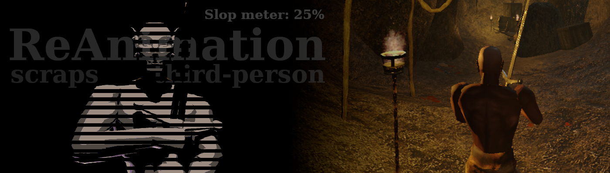
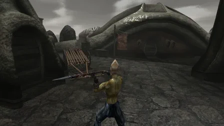
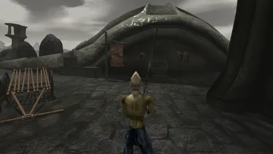
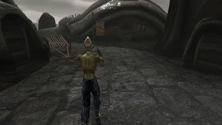
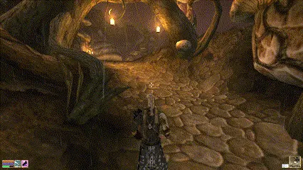
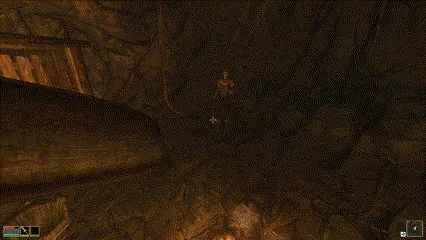

# 𖤝 ReAnimation - third-person - scraps


A semi-automated port of some of the ReAnimation v3 1st-person animations to 3rd person. Animations were manually adjusted to fit 3rd person better and were glued with the vanilla/Animation Compilation ones using a smart slop script (also provided), able to add nice-looking procedural upper-body motion based on human biomechanics research.

Covers spears and staves, two-handed swords, hand-to-hand and thrown weapons, for NPCs and for the 3rd-person view. Also includes the third-person one-handed animations from my [OpenMW One-handed animations and idle fixes](https://www.nexusmods.com/morrowind/mods/55059) mod - you don't need to install it, and it will be retired.

As mentioned, this has a good part of a vibe-coded, semi-procedural approach to it. But I would say it turned out quite well after some back and forth, and it does provide great consistency with ReAnimation v3 on those animations that it touches. To be frank, I personally don't care about said consistency so much and can wholeheartedly recommend other completely human-made 3rd-person animation mods, such as [3rd Person Alt Attacks](https://modding-openmw.com/mods/3rd-person-alt-attacks/) or [Morrowind Animation Overhaul (MAO)](https://www.nexusmods.com/morrowind/mods/60253) (Oblivion-ish style animations) or [Alternative Animation](https://www.nexusmods.com/morrowind/mods/58374), or anything that might come out in the future. You can also, of course, mix and match by simply removing the .kf files you don't like from the Animations folder of this or any other animation mod made for OpenMW (see Mixing animations below).

Developed for the OpenMW engine. **Requires OpenMW 0.51+**.

## 𖤝 Check out my cool donation banner

<p><a href="https://ko-fi.com/maxyari"></a><a href="https://ko-fi.com/maxyari"></a><br><a href="https://ko-fi.com/maxyari"></a></p>

Thank you for being around, and have fun :)

## 𖤝 Some gifs

(Give them some time to load)







## 𖤝 How to install

**Requires OpenMW 0.51+**

1) Install [ReAnimation v3](https://www.nexusmods.com/morrowind/mods/52596) and its dependency [Max Yari's Script Services (MSS)](https://www.nexusmods.com/morrowind/mods/60256).

2) Install this mod ([this tutorial](https://modding-openmw.com/tips/installing-mods/) explains how) and place it after ReAnimation and your other animation mods in the load order.

3) Enable `ReAnimation_ThirdPerson.omwscripts` in the "Content Files" tab of the OpenMW launcher, after `ReAnimation_API`.

4) OpenMW Launcher -> Settings -> Visuals -> Animations: "Use Additional Animation Sources" and "Smooth Animation Transitions" must be enabled!

## 𖤝 Recommended mods

[ReAnimation v3](https://www.nexusmods.com/morrowind/mods/52596) - the original first-person animations these were ported from (it's also required, so you already have it).

[Animation Compilation](https://www.nexusmods.com/morrowind/mods/43982) - these animations are built on its legs, so the animations this mod doesn't replace match best with it installed.

## 𖤝 Mixing animations

This works only for anims made in the OpenMW format, i.e. the ones that are placed inside the Animations folder. Unfortunately, OpenMW doesn't care about your load order here, since animation file names don't matter: animations aboba.kf and akika.kf can both override the 1h walk cycle, and OpenMW will use the one it loaded last (in alphabetical order). (Load order only matters when two mods have a file with the exact same name - then the later one replaces the other.) This mod's files all start with `xReAnim3P_`, so they load after most others and win.

So, to use different animations from different mods, you will have to go into the mod's Animations folder and delete the .kf files (and .yaml files with the same name, if there are any) corresponding to the anims you don't want to see from this mod - in both `xbase_anim` and `xbase_animkna` (the latter is for beast races). You will have to hope that other mods' anims are also split as nicely into separate anim files as this mod's, and you will have to more or less guess which files contain which anims based on their names, since, once again, names don't matter for the engine, so modders are free to name them whatever. In my mods, anim file names usually follow engine animation names loosely. Some names/shorthands that might help you:

- 1s = short blades (daggers, shortswords, etc.)
- 1h = one-handed (1h longswords, 1h maces, 1h axes, etc.)
- 2w = TwoWide = spears and staves
- 2c = TwoClose = regular two-handed weapons (claymores, 2h axes, warhammers, etc.)
- 1t = thrown weapons
- hh, h2h = hand-to-hand

## 𖤝 For Modders and Power Users

The script itself is slop-magic and allows you to essentially produce a whole, complete set of very passable 3rd-person animations, given a minimum of an idle pose and 3 attack types animated only on the upper body. The script just magically matches it up with 3rd-person legs and procedurally generates locomotion animations based on the idle pose that look... maybe not absolutely great, but certainly better than the original animations. So if you are planning to, say, make a novel weapon class but don't want to deal with all the dozens of animations that need to be made for running, walking, strafing, etc., you can avoid doing all of that completely.

You can also use the same script to make a 3rd-person version of any 1st-person anims that you like, such as MCAR, MAGIC, or anything else. You merely need Python to run it. It has many different tweakable parameters, with descriptions of those built into the interactive part of the script, but most likely you can just run it using the default settings and get a good output.

The script comes with ReAnimation: `Sources/Tools/FirstToThird/first_to_third.py` in its archive or [git repository](https://github.com/MaxYari/OpenMWReAnimation/tree/main/Sources/Tools/FirstToThird) (keep the `FBACompat` folder next to it; the script uses it). Run it without arguments to go through the settings one by one. This set was built from ReAnimation's folder with:

```
python3 Sources/Tools/FirstToThird/first_to_third.py -y \
  --first "../ReAnimation Scraps 3rd Person/Animations/1st person sources" \
  --third "../Animation Compilation 0.40-43982-0-40/Animation Compilation" \
  --legs-from "2hstaffspearguard=idle2w@start, 2hstaffspearrecoil=idle2w@start" \
  --prefix "xReAnim3P_"
```

## 𖤝 Credits

Legs and locomotion come from [Animation Compilation](https://www.nexusmods.com/morrowind/mods/43982) by Dirnae, Hrnchamd, thugqwerty, Artaios and Greatness7.
